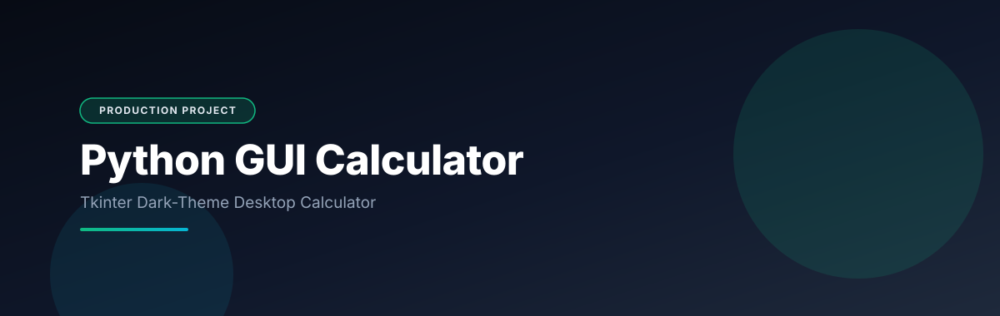
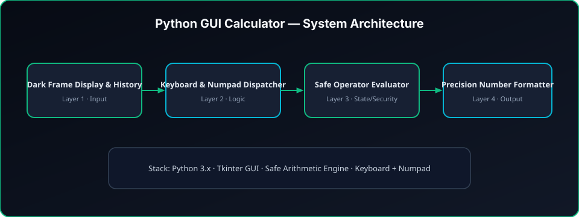
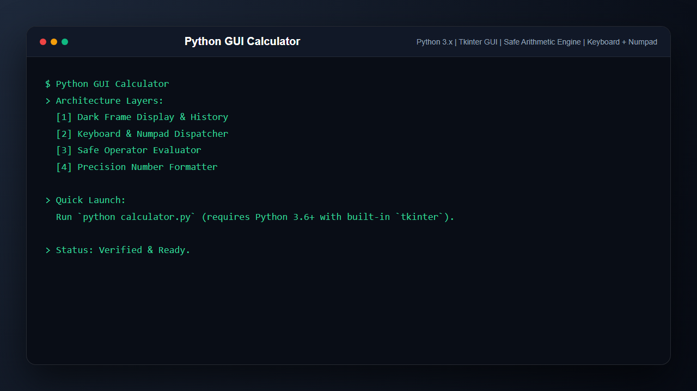

# Python GUI Calculator

> Tkinter Dark-Theme Desktop Calculator

    



## 📌 Executive Overview
Sleek dark-themed Python 3 Tkinter desktop calculator featuring safe operator dispatching (without `eval()`), full keyboard & numpad bindings, operator chaining, and division-by-zero handling.

---

## 🏛️ System Architecture



---

## 🖥️ Interface & CLI Preview



---

## 🛠️ Tech Stack
- **Python 3.x**
- **Tkinter GUI**
- **Safe Arithmetic Engine**
- **Keyboard + Numpad**

---

## 🚀 How to Run

1. **Clone the repository:**
   ```bash
   git clone https://github.com/royalodi/python-calculator.git
   cd python-calculator
   ```

2. **Launch locally:**
   Run `python calculator.py` (requires Python 3.6+ with built-in `tkinter`).

---

## 👨‍💻 Author & Lead Maintainer

<table>
  <tr>
    <td align="center" width="150" valign="middle">
      <a href="https://github.com/royalodi">
        
      </a>
      <br /><br />
      <b>Royal Odi</b><br />
      <sub><i>Full-Stack Engineer</i></sub>
    </td>
    <td valign="top">
      <p>
        Designed, engineered, and maintained by <b>Royal Odi</b>. Full-Stack Engineer focused on building scalable web architectures, robust backend systems, and responsive, high-performance digital experiences.
      </p>
      <p>
        <a href="https://github.com/royalodi"></a>
        <a href="mailto:royalodi.dev@gmail.com"></a>
        <a href="https://github.com/royalodi?tab=repositories"></a>
      </p>
    </td>
  </tr>
</table>

---

## 📄 License
Distributed under the **MIT License**.
